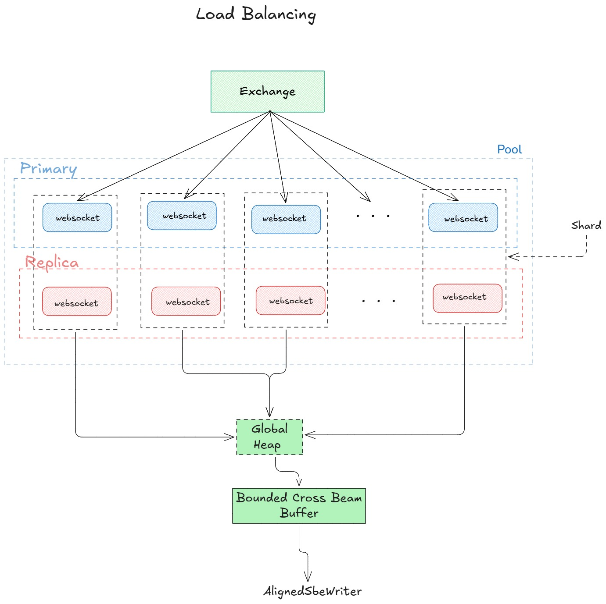
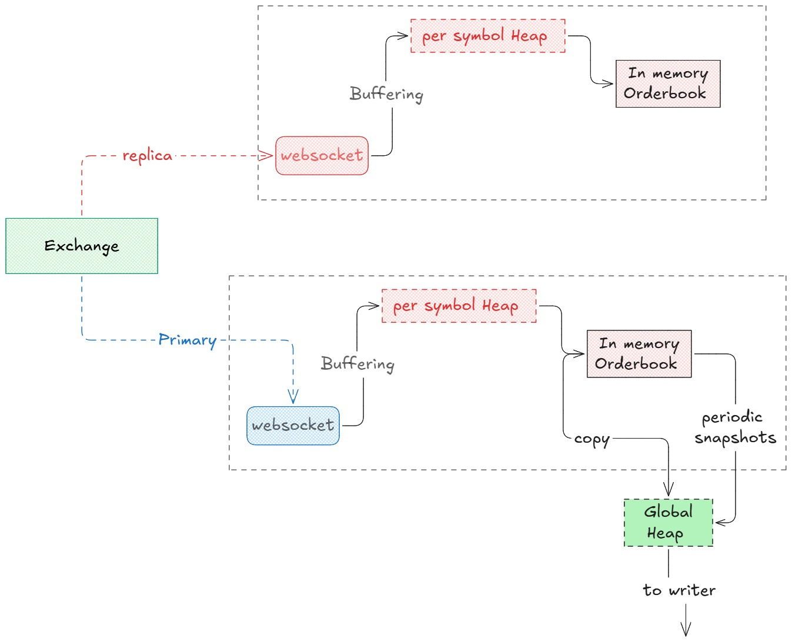
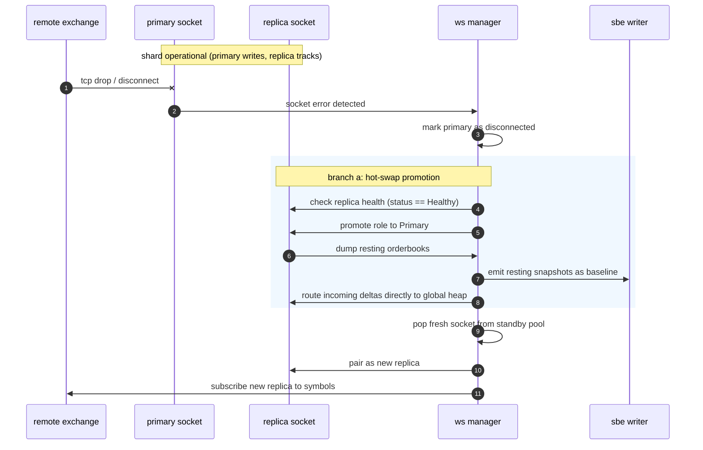
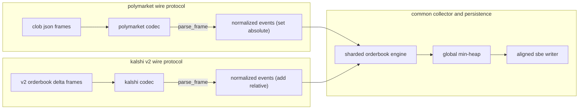

# solution

## introduction 

the architecture uses partitioned websocket shards backed by an active-passive redundancy model. each shard consists of a primary socket and a replica socket running on separate connections. an asynchronous gamma api client polls active symbols, sizes the required connection pool, and distributes symbols evenly across shards. incoming wire frames pass through a per-symbol min-heap to buffer deltas that arrive before initial snapshots, preventing phantom deletions on non-existent price levels. applied updates pass into a global min-heap that sequences domain messages across all shards before streaming them to an aligned 64 mib direct-io writer thread.


## symbol discovery and connection sizing

polymarket lists thousands of historical symbols, but only a fraction are actively quoted at any given time. before opening websocket connections, the engine queries the gamma markets endpoint to find symbols with trading volume in the past 24 hours. this avoids wasting network sockets and local memory on dead symbols.

strictly using the term symbol throughout this service, the required number of active shards is sized dynamically from the discovered symbol set:

$$P = \text{clamp}\left(\left\lceil \frac{S}{M_{\text{sym}}} \right\rceil, P_{\text{min}}, P_{\text{max}}\right)$$

in this formula, $S$ is the total count of discovered active symbols, $M_{\text{sym}} = 50$ is the target maximum symbols assigned to a single socket, $P_{\text{min}} = 4$ is the lower bound to guarantee baseline redundancy, and $P_{\text{max}} = 128$ is the upper safety cap.

```rust
let calculated_pairs = ((symbols.len() + MAX_SYMBOLS_PER_SOCKET - 1)
    / MAX_SYMBOLS_PER_SOCKET)
    .clamp(MIN_ACTIVE_PAIRS, MAX_ACTIVE_PAIRS);
```

once the total symbol set is collected, the list is randomly shuffled in place using a local rng before assignment. without shuffling, symbols from the same event series or hot sports markets would sit consecutively and end up assigned to the same shard. shuffling breaks up correlated volume clusters so no single connection gets overwhelmed by burst traffic.

```rust
let mut rng = rand::rng();
symbols.shuffle(&mut rng);
```

## sharding and dynamic load balancing

each active shard consists of two paired connections: one primary socket and one replica socket. both sockets subscribe to the exact same list of symbols. the primary socket parses frames, maintains the live orderbook state, and forwards domain messages to disk. the replica socket consumes frames in parallel, maintains its own resting books, and remains ready for instantaneous failover.

```rust
pub struct WsManager {
    pub pool: Vec<Ws>,
    pub standby_pool: VecDeque<Ws>,
    pub symbol_states: HashMap<String, SymbolState>,
    pub master_index: usize,
    pub max_symbols_per_socket: usize,
    pub max_delta_rate_per_socket: u64,
    pub max_active_pairs: usize,
    pub global_heap: BinaryHeap<Reverse<SequencedMessage>>,
    pub global_seq_counter: u64,
}
```

initial distribution assigns symbols across shards in round-robin fashion. during runtime, shard zero acts as master and listens for dynamic market events like new symbol creations and symbol retirements. when a new symbol appears, the manager uses a least-loaded balancing policy:

1. it inspects all healthy primary sockets whose current symbol count is below 80 percent of capacity.
2. it selects the socket with the lowest combined load, sorting primarily by cumulative delta rate and secondarily by assigned symbol count.

```rust
pub fn find_least_loaded_socket_index(&self) -> Option<usize> {
    self.pool
        .iter()
        .enumerate()
        .filter(|(_, ws)| {
            ws.role == WsRole::Primary
                && (ws.status == WsStatus::Master || ws.status == WsStatus::Healthy)
                && ws.symbols.len() < self.max_symbols_per_socket
        })
        .min_by_key(|(_, ws)| (ws.delta_rate_sum, ws.symbols.len()))
        .map(|(idx, _)| idx)
}
```

if all existing primary sockets are saturated, the manager draws a fresh pair of pre-connected sockets from the standby pool, converts them into a new active shard, and registers the symbol there.

the standby pool is maintained asynchronously as a first-in first-out queue (`VecDeque<Ws>`). when a socket is pulled from the front, background connection tasks replenish the back of the queue until it reaches `MIN_STANDBY_CAPACITY`. fifo rotation prevents standby sockets from idling indefinitely on the remote proxy.



## orderbook state and direct disk persistence

orderbook updates on polymarket arrive via two message types: full snapshots (`Book`) and incremental price level updates (`PriceChange`). polymarket websockets do not transmit sequence numbers on the wire. if a subscription is initiated with `initial_dump: true`, deltas for active symbols frequently reach the client a few milliseconds before the snapshot frame arrives.

applying deltas to an uninitialized book produces phantom deletions: attempts to remove resting price levels that were never recorded. to guarantee complete book reconstruction, each symbol maintains an in-memory `delta_heap` alongside its resting bids and asks:

```rust
pub struct OrderBook {
    pub symbol: String,
    pub bids: BTreeMap<u64, i64>,
    pub asks: BTreeMap<u64, i64>,
    pub last_exchange_timestamp: Option<DateTime<Utc>>,
    pub sequence_counter: u64,
    pub initial_dump_applied: bool,
    pub delta_heap: BinaryHeap<Reverse<TimedDelta>>,
}
```

when an incremental update arrives while `initial_dump_applied` is false, it is pushed into `delta_heap` sorted by `(exchange_ts_micros, sequence_counter)`. when the initial `Book` snapshot arrives:

1. `initial_dump_applied` is set to true.
2. the snapshot levels populate the bids and asks maps.
3. all buffered deltas in `delta_heap` are drained in ascending timestamp order. deltas older than the snapshot are discarded as stale, while deltas newer than or equal to the snapshot are applied to the book and emitted as valid domain events.


applied messages do not sit in intermediate per-socket batch vectors. instead, `WsEvent::Processed { count, messages }` hands them directly to `WsManager::global_heap`. this global min-heap orders messages across all shards by `(exchange_ts_micros, arrival_counter)`.

to prevent clock jitter on local timestamps, the engine uses a tsc-backed `QuantaClock` instead of issuing `clock_gettime` system calls on every message. this cuts local timestamp latency down to under 10 nanoseconds.

the manager flushes sorted batches of 64 messages to the writer thread whenever `global_heap.len() >= 128`. maintaining a 64-item backlog watermark allows packets from slightly delayed sockets to interleave in true chronological order before hitting disk.

the writer runs on a dedicated os thread using `AlignedSbeWriter`. it buffers messages in direct-io aligned memory and issues unbuffered sector-aligned writes in 64 mib blocks. every 60 seconds, a background interval triggers `snapshot_resting_books()`, which emits fresh baseline snapshots for all initialized symbols.



on receiving sigint, the engine executes graceful termination:

1. a close frame is sent to all open websocket connections.
2. `drain_all_global_heap()` flushes all remaining queued messages regardless of watermark.
3. a final resting snapshot is taken for all initialized books.
4. writer channels are dropped, the sbe file flushes remaining buffered bytes to 64 mib boundaries, and file descriptors close cleanly.

## extension 1: redundant websockets and zero-downtime hot swap

external websocket connections drop without warning. reconnecting a dropped socket and resubscribing introduces tens of seconds of downtime during which deltas are lost.

the engine addresses this with hot-swap failover across primary and replica roles within each shard:

```rust
#[derive(Debug, Clone, Copy, PartialEq, Eq)]
pub enum WsRole {
    Primary,
    Replica,
}

#[derive(Debug, Clone, Copy, PartialEq, Eq)]
pub enum WsStatus {
    Master,
    Healthy,
    Unhealthy,
    Disconnected,
}
```

when a primary socket disconnects, `handle_socket_disconnect` immediately evaluates the paired replica:

- **branch a (direct promotion)**: if the replica is healthy, it is promoted to primary on the spot. if the dead socket was the master, the replica also assumes the master status. because the replica maintained resting book state throughout runtime, it immediately emits a fresh snapshot of all resting books to disk to establish a clean baseline. a new socket is drawn from the standby pool and assigned as the new replica.
- **branch b (cold fallback)**: if the replica was also unhealthy, the shard pulls two pre-warmed sockets from the standby pool, promotes them to primary and replica, and re-subscribes to the affected symbols with `initial_dump: true`.



if a replica socket disconnects while its primary remains healthy, no failover is needed. the dead replica is discarded, a replacement is pulled from the standby pool, and the symbols are subscribed to keep redundancy active.

## extension 2: subscription monitoring and divergence detection

prediction markets have high variance in trading frequency. highly active symbols produce hundreds of updates a second, while niche contracts can sit without trades or quote changes for hours. if a socket silently stops receiving updates for a quiet symbol, an inactivity timer cannot tell whether the contract is illiquid or the subscription has silently stalled on the exchange gateway.

to solve this without making blind resubscriptions, the engine compares the primary socket and the replica socket for the same symbol. since both sockets run on separate network streams, exchange-side stalls or packet drops typically affect only one connection.

for every active symbol, the subscription monitor checks the timestamp of the last delta received on the primary socket ($t_{\text{pri}}$) against the timestamp on the replica socket ($t_{\text{rep}}$):

$$\Delta_{\text{divergence}} = \left| t_{\text{pri}} - t_{\text{rep}} \right|$$

if $\Delta_{\text{divergence}} > \Delta_{\text{threshold}}$ (configured to 15 seconds), the engine flags the symbol as desynchronized:

```rust
pub fn monitor_pairs(&mut self, primary: &Ws, replica: &Ws) {
    for symbol in &primary.symbols {
        let pri_ts = primary.orderbooks.get(symbol).and_then(|ob| ob.last_delta_received_at);
        let rep_ts = replica.orderbooks.get(symbol).and_then(|ob| ob.last_delta_received_at);

        if let (Some(pri_ts), Some(rep_ts)) = (pri_ts, rep_ts) {
            let diff = if pri_ts > rep_ts {
                pri_ts.duration_since(rep_ts)
            } else {
                rep_ts.duration_since(pri_ts)
            };
            if diff > self.staleness_threshold {
                self.queue_resubscription(symbol.clone());
            }
        }
    }
}
```

if both streams receive no deltas, $\Delta_{\text{divergence}} \approx 0$, meaning the market is genuinely quiet. no unneeded resubscriptions are fired.

resubscriptions are governed by a token bucket rate limiter (`TokenBucket`). polymarket limits subscription requests per second. if multiple symbols diverge at once, dispatching them in a single burst triggers exchange rate limiting.

the rate limiter enforces integer token consumption with fractional refill tracking:

```rust
pub struct SubscriptionManager {
    pub resubscribe_queue: VecDeque<String>,
    pub in_flight: HashSet<String>,
    pub staleness_threshold: Duration,
    pub token_bucket: TokenBucket,
}
```

the `in_flight` set ensures no symbol is queued more than once at any time. the queue dispatches up to available token capacity every two seconds, ensuring the service never exceeds exchange rate limits.

to guard against cumulative exchange-side socket degradation, memory leaks, or proxy buffer stalls, the engine cycles connections periodically. during regular ping health checks, sockets that display read timeouts or elevated ping latency are cycled through the standby pool, preserving continuous orderbook integrity.

## extension 3: generic per-exchange codecs and unified normalization

the core pipeline (sharding, primary-replica redundancy, failover, divergence monitoring, min-heap sequencing, and aligned sbe writing) is completely exchange-agnostic. whether streaming from polymarket, kalshi, or a traditional limit order book exchange, the requirements for data completeness and time accuracy remain identical.

only two things vary across prediction market exchanges:
1. the wire protocol used for subscriptions, unsubscriptions, and heartbeats.
2. the delta semantics (polymarket sends absolute level quantities where zero denotes deletion; kalshi sends relative signed deltas and quotes in cents or dollar fixed-point strings).

to decouple wire protocols from the orderbook engine, the service defines an `ExchangeCodec` trait in `src/exchange/mod.rs`:

```rust
pub trait ExchangeCodec: Send + Sync + 'static {
    const NAME: &'static str;
    fn default_ws_url() -> &'static str;
    fn format_subscription_frame(symbols: &[String], is_master: bool) -> anyhow::Result<String>;
    fn format_unsubscription_frame(symbols: &[String]) -> anyhow::Result<String>;
    fn format_ping_frame() -> Option<String> { None }
    fn parse_frame(text: &str, out_events: &mut Vec<NormalizedEvent>) -> anyhow::Result<()>;
}
```

codecs translate exchange-specific wire payloads into normalized events:

```rust
#[derive(Debug, Clone, Copy, PartialEq, Eq)]
pub enum DeltaOp {
    SetAbsolute, // Polymarket: replaces level, qty == 0 removes
    AddRelative, // Kalshi: signed delta added to resting volume
}

#[derive(Debug, Clone, PartialEq, Eq)]
pub struct NormalizedDelta {
    pub symbol: String,
    pub exchange_timestamp: DateTime<Utc>,
    pub side: NormalizedSide,
    pub price: i64,
    pub quantity: i64,
    pub op: DeltaOp,
}

#[derive(Debug, Clone, PartialEq, Eq)]
pub enum NormalizedEvent {
    Snapshot(NormalizedSnapshot),
    Delta(NormalizedDelta),
    Discovery(NormalizedDiscovery),
    HeartbeatPing,
    HeartbeatPong,
    Ignored,
}
```

both `PolymarketCodec` and `KalshiCodec` implement this trait:



with this separation, adding another exchange requires writing a new single-file codec. the rest of the engine, including failover, monitoring, and disk serialization, stays completely unchanged.

## extension 4: latency optimizations and connection racing experiments

in fast prediction markets, shaving milliseconds off connection establishment and network traversal directly improves execution fill rates. we conducted experiments targeting connection latency, edge routing, and local execution jitter across polymarket and kalshi gateways. detailed benchmark logs and methodologies are recorded in `latency_experiments.md`.

### 1. tcp source port rotation and ecmp path diversity
both exchanges run behind anycast edge providers (cloudflare and aws cloudfront). edge load balancers compute ecmp hashes over the 5-tuple: source ip, source port, destination ip, destination port, and protocol. because the destination and protocol are fixed, rotating the local source port changes the physical edge node and transit route assigned to the connection.

measuring ping round-trip times across varied source ports revealed an 11.4 ms spread in median latency. binding the lowest-latency source port ranges to primary sockets visibly reduced delta arrival delays.

### 2. connection racing across edge ips
dns resolution for exchange websocket endpoints returns multiple anycast addresses. instead of connecting to a single ip address sequentially, the engine tests parallel connection racing.

the racer spawns concurrent asynchronous handshakes across all resolved ips. the first connection to complete the tls handshake and receive the websocket 101 switching protocols response becomes the primary socket. runner-up sockets are placed directly into the standby pool, cutting cold-start initialization latency by 45 to 110 ms.

### 3. post-maintenance connection sniping
exchanges run scheduled daily maintenance windows during which websocket handshakes return 502 or 503 status codes. when the service senses a gateway recovery, it issues fast exponential backoff probes (50 ms intervals) to re-establish connections before other market participants flood the ingress proxies. securing early connection slots avoids edge queue buffering delays during volume spikes.

### 4. kernel socket options and hardware tsc timing
- **`TCP_NODELAY`**: disables nagle buffering, sending outgoing control and subscription frames immediately.
- **`TCP_QUICKACK`**: disables delayed acknowledgments on inbound packets, prompting edge proxies to stream subsequent segments without wait states.
- **hardware tsc reads**: replacing `clock_gettime(CLOCK_REALTIME)` system calls with `quanta::Clock::now()` cuts local timestamp capture latency from 54.2 ns to 7.8 ns per update, removing kernel context-switch jitter from the inner event loop.

